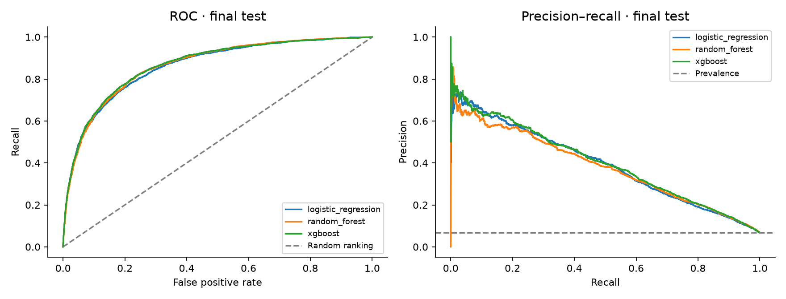
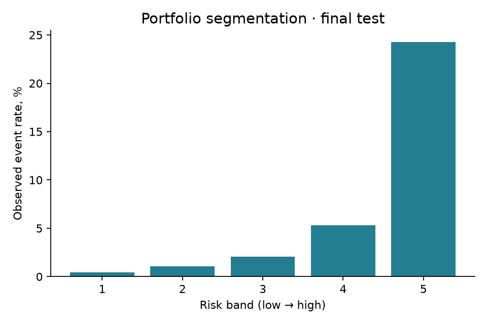
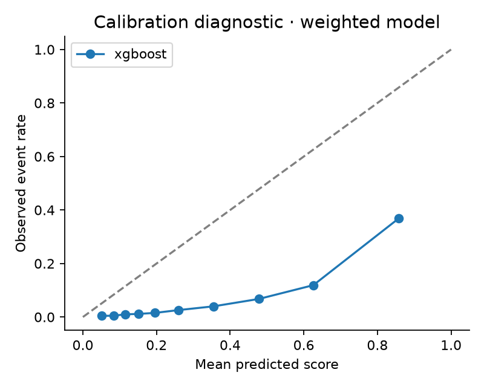

# Credit Risk · от прогноза просрочки к анализу решений

**Учебный проект по риск-аналитике:** оценка риска серьёзной просрочки, сравнение моделей и анализ компромисса между долей одобрений и пропущенными проблемными заёмщиками.

[Ноутбук в репозитории](notebooks/credit_risk_analysis.ipynb) · [Открыть Colab](https://colab.research.google.com/drive/1piGd2mL2LYhZ8vW1AA6VbqfgLLOnYpu1) · [Данные на Kaggle](https://www.kaggle.com/competitions/GiveMeSomeCredit/data) · [Результаты эксперимента](reports/test_metrics.csv)

> **Статус:** полный baseline-эксперимент выполнен пользователем локально. Ниже — его фактические отчёты для обновлённого протокола. В ноутбук импортированы результаты этого запуска; ячейки ноутбука автоматически не выполнялись.

## Задача и данные

Используется **Give Me Some Credit**, не Home Credit. Целевая переменная `SeriousDlqin2yrs` — серьёзная просрочка (90 дней и более) в течение двух лет. Это целевое событие датасета; в проекте оно используется как индикатор кредитного риска, без утверждения о соответствии регуляторному определению дефолта.

Признаки: возраст, использование необеспеченных кредитных линий, долговая нагрузка, месячный доход, количество кредитов, иждивенцев и исторических просрочек. Идентификатор клиента в модель не включается. CSV загружается пользователем с Kaggle и не публикуется в репозитории.

## Что исследуется

- **SQL и EDA:** структура данных, пропуски, распределение целевого события и риск по сегментам.
- **Модели:** Logistic Regression как интерпретируемый baseline, Random Forest и XGBoost.
- **Валидация:** стратифицированное разделение 60/20/20; выбор модели по validation ROC-AUC, выбор порога на validation, финальная оценка на test.
- **Качество ранжирования:** ROC-AUC и Average Precision (AP), bootstrap-интервалы и парное сравнение с логистической регрессией.
- **Решения:** доля условных одобрений, частота целевого события среди одобренных и recall проблемных клиентов.
- **Диагностика:** ROC/PR-кривые, калибровка и группы риска.

Медианы и границы clipping обучаются только на train. При Optuna-поиске весь preprocessing находится внутри CV-pipeline. Пропуски и необычные значения сохраняются отдельными индикаторами. Правила обработки возраста и больших счётчиков просрочек — допущения, которые требуют проверки на устойчивость.

## Результаты локального эксперимента

Обучение выполнено пользователем на своём компьютере. **90 000 train / 30 000 validation / 30 000 test**, seed 42. На test — 2 005 целевых событий из 30 000 (6.68%). Модель выбрана по validation ROC-AUC, до финальной оценки на test.

| Модель | Test ROC-AUC | 95% bootstrap CI | Test AP | 95% bootstrap CI |
|:--|--:|:--|--:|:--|
| Logistic Regression | 0.8607 | [0.8527; 0.8696] | 0.3912 | [0.3682; 0.4127] |
| Random Forest | 0.8646 | [0.8567; 0.8729] | 0.3810 | [0.3565; 0.4018] |
| **XGBoost** | **0.8669** | **[0.8592; 0.8752]** | **0.3995** | **[0.3749; 0.4222]** |

Источники: [test-метрики](reports/test_metrics.csv), [validation-метрики](reports/validation_metrics.csv), [параметры среды и хеш данных](reports/run.json). Интервалы построены по 200 bootstrap-повторам; их границы имеют заметную Monte Carlo-погрешность. AP рассчитана через `average_precision_score`, а не трапецеидальную площадь под PR-кривой.



XGBoost выбран на validation (ROC-AUC 0.8633). На test его преимущество над Logistic Regression составляет **+0.0062 ROC-AUC**; парный bootstrap-интервал разницы **[+0.0029; +0.0088]** не включает ноль. Это поддерживает небольшой выигрыш на данном split; не доказывает устойчивость во времени. Статистическая определённость выигрыша AP отдельно не проверялась. [Парное сравнение](reports/paired_comparison.json)

### Порог и условные одобрения

Порог **0.4405** выбран на validation для recall 80%. На test recall составил **81.70%**: выявлено 1 638 из 2 005 проблемных клиентов, пропущено 367. Условно одобрены 21 658 заявок (**72.19%**), частота серьёзной просрочки среди них — **1.69%**. Среди условно отклонённых — 6 704 клиента без целевого события. Это показывает цену высокого recall. [Политика и confusion counts](reports/policy.json)

| Целевой recall на validation | Порог | Фактический recall на test | Условные одобрения | Просрочка среди одобренных |
|--:|--:|--:|--:|--:|
| 50% | 0.7606 | 51.12% | 91.27% | 3.58% |
| 65% | 0.6064 | 67.08% | 84.05% | 2.62% |
| **80%** | **0.4405** | **81.70%** | **72.19%** | **1.69%** |
| 90% | 0.2766 | 90.82% | 57.06% | 1.07% |

Все пороги определены на validation. Таблица описывает заранее заданные сценарии на test; она не используется для нового выбора порога. Это ретроспективная симуляция, не оценка прибыли и не доказательство причинного снижения риска. [Исходные сценарии](reports/threshold_scenarios.csv)

### Группы риска и калибровка

Частота целевого события монотонно растёт от **0.47%** в нижней группе скора до **24.27%** в верхней. Границы групп определены по validation. Это полезная сегментация портфеля по наблюдаемому риску. [Таблица групп](reports/risk_bands.csv)



При этом XGBoost заметно **завышает вероятности**: например, в верхней группе средний score равен 0.740, а частота события — 0.243. Выход модели следует интерпретировать как риск-скор, а не готовую откалиброванную PD. Для применения вероятностей нужна отдельная калибровка на данных, не использовавшихся для обучения. Сегодня модель не перенастраивалась после просмотра test.



### История экспериментов

[Архив прежней версии](models/final_results.csv) содержит ROC-AUC около 0.872 и AP около 0.404 для tuned XGBoost. В прежнем коде preprocessing вычислялся до split, а точечные метрики были bootstrap-средними. Изменились и split, и подготовка, и конфигурация модели; разницу старых и новых чисел нельзя приписать только исправлению утечки. Актуальные выводы выше основаны на новом запуске.

## Как запустить на своём компьютере

Тяжёлые расчёты запускает пользователь. GPU для этих baseline-моделей не требуется.

```bash
python -m venv .venv
# Windows PowerShell:
.venv\Scripts\Activate.ps1
# macOS / Linux:
# source .venv/bin/activate

pip install -r requirements.txt
# Скачать cs-training.csv с Kaggle в data/raw/cs-training.csv
python src/load_data.py
python src/eda.py

# ОБУЧЕНИЕ: запускается отдельно, использует CPU
python src/train.py

# ОЦЕНКА: bootstrap использует CPU; модель не переобучается
python src/evaluate.py --bootstrap 200
```

Необязательный длительный поиск параметров: `python src/tune.py` после baseline-обучения и **до** просмотра test. После этого запустить оценку один раз. Для более устойчивых bootstrap-квантилей можно использовать 1000 повторов; новый просмотр test не должен превращаться в цикл подбора модели.

Для ноутбука установите JupyterLab: `pip install jupyterlab`, затем `jupyter lab notebooks/credit_risk_analysis.ipynb`. В Colab можно подключить локальную среду выполнения; обычная размещённая среда Colab использует облачные ресурсы Google. Ноутбук не запускает обучение, пока явно не включён флаг.

## Интерпретация риск-решений

Порог по умолчанию выбирается для recall не ниже 80% **на validation**. Это учебный ориентир, а не оптимальная банковская политика; на test целевой recall не гарантирован. Дополнительные сценарии используют пороги, также определённые на validation.

Заявки со score ниже порога условно считаются одобренными. Это ретроспективная симуляция на размеченной выборке: она не учитывает отклонённых в реальности заявителей, изменение поведения и эффект кредитного решения. Без EAD, LGD, ставки и затрат проект не оценивает прибыль или ожидаемые денежные потери.

Взвешенные модели не следует автоматически считать калиброванными PD. График калибровки показывает отклонения; отдельная процедура калибровки пока не реализована.

## Структура

```text
notebooks/credit_risk_analysis.ipynb  # пошаговое исследование и запуск
src/load_data.py                     # CSV → SQLite, проверки схемы
src/eda.py                           # SQL-анализ и статистические тесты
src/preprocess.py                    # splits и train-fitted preprocessing
src/train.py                         # три baseline-pipeline
src/tune.py                          # необязательный Optuna / 5-fold CV
src/evaluate.py                      # метрики, сценарии, графики
sql/                                # схема и аналитические запросы
models/*_results.csv                 # архив прежнего эксперимента
models/current/                     # локальные модели и версии пакетов (gitignored)
reports/                            # отчёты нового запуска
tests/                              # небольшие проверки утечки и разделения
```

## Ограничения

Случайный стратифицированный split не доказывает устойчивость во времени; временной валидации нет. Наблюдаемые связи в сегментах не являются причинными эффектами. Проверки справедливости, мониторинг сдвига данных, отдельная калибровка и production-развёртывание остаются за рамками этой версии.

## Следующее развитие

Проверить обработку аномалий и веса классов внутри CV, исследовать калибровку, расширить анализ ошибок. Переход на Home Credit — отдельный этап с признаками из связанных таблиц и кредитной истории.
